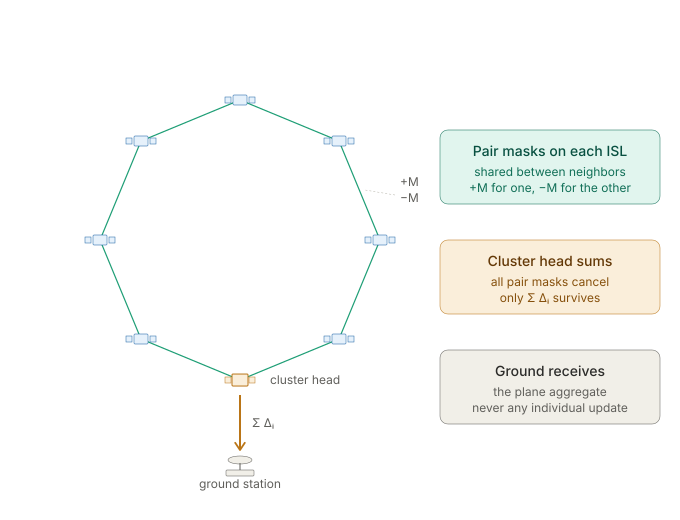
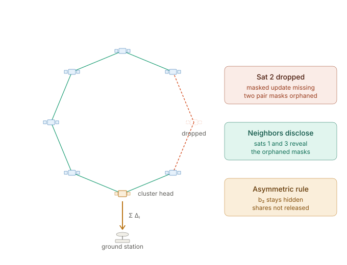

# HFL-SIPA

**Hierarchical Federated Learning with Secure Intra-Plane Aggregation** — a
research prototype for privacy-preserving federated learning across LEO
satellite constellations. Satellites in the same orbital plane form a ring
and securely aggregate local model updates over inter-satellite links (ISL);
only plane-level aggregates ever reach the ground.

> **Status:** in-process simulation, suitable for studying the protocol and
> its dropout behaviour. **Not deployable.** See [Limitations](#limitations).

<p align="center">
  
</p>

## What this repo covers

Three ideas tailored to the LEO-constellation setting:

1. **Ring-structured secure aggregation.** Pairwise-mask SecAgg specialised
   to the ring topology that orbital planes naturally provide. Mask
   cancellation is bit-exact in fixed-point arithmetic; the cluster head
   learns nothing about any individual update.

2. **Dropout recovery via self-masks and Shamir sharing.** Tolerates any
   `N − t` in-plane dropouts and any silent-but-alive sats, with an
   asymmetric disclosure rule that defends against late-arrival unmasking
   by an honest-but-curious cluster head.

3. **Hierarchical aggregation surface.** Satellites in one plane aggregate
   over ISL; a rotating cluster head forwards a single plane-level
   aggregate during its next ground contact. The ground server only ever
   sees plane-level sums.

The full HFL-SIPA design also includes staleness-weighted asynchronous
aggregation at the ground server and DP-noise composition. Those pieces are
described below but not yet implemented — see [Roadmap](#roadmap).

## Install

Requires Python 3.10+.

```bash
git clone https://github.com/<your-username>/hfl-sipa.git
cd hfl-sipa
pip install -e ".[dev]"
```

## Quick start

```python
import numpy as np
from hfl_sipa import setup_plane, begin_round, run_round

rng = np.random.default_rng(0)
N, D, T = 8, 10_000, 5           # 8 sats, 10k-dim update, threshold 5
sats = setup_plane(N, D, T)
begin_round(sats, round_id=0)

deltas = {i: rng.standard_normal(D) * 0.01 for i in range(N)}
agg = run_round(sats, deltas, round_id=0)

print(np.max(np.abs(agg - sum(deltas.values()))))   # ~1e-5, quantization only
```

With dropouts:

```python
begin_round(sats, round_id=1)
deltas = {i: rng.standard_normal(D) * 0.01 for i in range(N)}
agg = run_round(sats, deltas, round_id=1, dropped={2}, silent={5})
# agg = sum over surviving sats (all except sat 2), with sat 5's b_i
# reconstructed from Shamir shares held by peers.
```

Runnable demos:

```bash
python examples/basic_ring.py
python examples/dropout_recovery.py
```

## Protocol summary

For a plane of `N` satellites with threshold `t`:

**Setup (one-time).** Each pair of ring neighbours performs X25519 ECDH to
derive a long-term shared secret. Per-round pair masks are HKDF-derived from
that secret plus the round id, so disclosing one round's masks does not
compromise other rounds.

**Round flow.**

1. **Begin round.** Each sat samples a fresh self-secret `b_i`, splits it
   `t`-of-`(N − 1)` via Shamir, and distributes shares to all other plane
   sats over ISL.

2. **Mask.** Each sat masks its quantized local update with two pair masks
   (one per ring neighbour) and one self-mask:

   ```
   masked_i = quantize(delta_i)
            + sign(i, right_neighbour) * PRG(seed_right)
            + sign(i, left_neighbour)  * PRG(seed_left)
            + PRG(seed_self)
   ```

   Pair masks telescope around the ring; self-masks survive.

3. **Aggregate.** Cluster head sums received masked vectors. For each
   surviving sat, subtract its self-mask (sat discloses `b_i` directly, or
   peers reconstruct via Shamir if it became silent). For each dropped sat,
   subtract orphaned pair masks (surviving neighbours disclose them).
   Dequantize.

4. **Forward.** A single plane-level aggregate is uplinked during the
   cluster head's next ground contact.

### Dropout recovery

<p align="center">
  
</p>

When a satellite goes silent mid-round, its two pair-mask edges to ring
neighbours are orphaned. The neighbours still hold the shared secrets for
those edges, so they can disclose the per-round mask values to the cluster
head, which subtracts them off.

**Asymmetric disclosure rule.** Each satellite is in exactly one state per
round: *alive* or *dropped*. Honest peers release Shamir shares of `b_i`
only for alive sats; honest neighbours disclose pair masks only for dropped
sats. This mutual exclusion is what defeats late-arrival unmasking — even
with all pair masks for sat `k` in hand, the cluster head cannot recover
`delta_k` because it does not know `b_k`. The rule is enforced in
`Satellite.disclose_share` and `Satellite.disclose_pair_mask`, which raise
`PermissionError` on violation.

### Threshold choice

With `N = 8, t = 5` (the demo default): any 3 simultaneous dropouts
tolerated; 5 colluding peers needed to reconstruct an honest sat's `b_i`.
Natural choice is `t ≈ N/2`, which gives equal slack on both sides. For a
constellation with eclipse-correlated dropouts across nearby sats, smaller
`t` survives the eclipse at the cost of weaker collusion resistance within
the plane.

## Repository layout

```
hfl-sipa/
├── hfl_sipa/                    # Package
│   ├── crypto.py                # PRG, HKDF-derived mask seeds, fixed-point quantization
│   ├── shamir.py                # Shamir secret sharing over the 13th Mersenne prime
│   ├── satellite.py             # Satellite: masking + enforced disclosure
│   ├── cluster_head.py          # Aggregation + dropout recovery
│   └── protocol.py              # setup_plane, begin_round, run_round
├── tests/                       # pytest suite
├── examples/                    # Runnable demos
└── docs/diagrams/               # SVG figures (used in this README)
```

## Testing

```bash
pytest                          # all tests
pytest --cov=hfl_sipa            # with coverage
pytest tests/test_dropout.py -v  # focused
```

CI runs the suite on Python 3.10, 3.11 and 3.12 (see `.github/workflows/ci.yml`).

## Prior work

This prototype builds on three lines of work named in the source project brief:

- **Flame** — Daga, Shin, Garg, Gavrilovska, Lee, Kompella. *Flame:
  Simplifying Topology Extension in Federated Learning.* SoCC '23.
  [paper](https://doi.org/10.1145/3620678.3624665) ·
  [code](https://github.com/cisco-open/flame)

  A flexible FL system that decouples the topology of an FL job from its
  training logic. The natural runtime to host the per-plane and ground-side
  roles of HFL-SIPA — the hierarchical structure here maps cleanly to
  Flame's topology abstractions.

- **Krios** — *Krios: Scheduling Abstractions and Mechanisms for Enabling a
  LEO Compute Cloud.* SoCC '24.
  [paper](https://doi.org/10.1145/3698038.3698566)

  Scheduling primitives for treating an LEO constellation as a compute
  cloud. Directly relevant for placing the rotating cluster-head role
  given predictable orbital schedules and ground-pass windows.

- **Felix** — Garg, Sanyal, Lee, Tumanov, Gavrilovska, Yoneki, Payberah.
  *Client Availability in Federated Learning: It Matters!* EuroMLSys '25.
  [paper](https://doi.org/10.1145/3721146.3721964)

  Quantifies how client unavailability degrades time-to-accuracy in
  cross-device FL and motivates availability-aware aggregation. Maps
  directly to satellite mobility and eclipse-correlated dropouts.

The cryptographic core is standard:

- Bonawitz et al. *Practical Secure Aggregation for Privacy-Preserving
  Machine Learning.* CCS '17. — pairwise-mask SecAgg with self-masks and
  Shamir-shared seeds; the basis for the ring construction and dropout
  recovery here.
- Bell, Bonawitz, Gascón, Lepoint, Raykova. *Secure Single-Server
  Aggregation with (Poly)Logarithmic Overhead.* CCS '20. — relevant for
  the verifiable-aggregation extension noted below.

## Limitations

This is a single-process simulation; a deployable system would need at
minimum:

- **Authenticated PKI.** Public keys are exchanged in plaintext at setup;
  in deployment they must be signed at provisioning so a network attacker
  cannot MITM the pair Diffie–Hellman.
- **Signed survivor-set commitment.** The cluster head's published survivor
  set must be signed and atomically broadcast before any disclosures begin.
  Honest peers should refuse to disclose under conflicting views.
- **Verifiable aggregation.** The cluster head is currently trusted not to
  misreport the aggregate it forwards. Bell et al. (CCS '20) and successor
  work show how to add a SNARK over the aggregation step.
- **Eclipse-correlated dropouts.** Threshold sharing within a single plane
  fails if the entire plane darkens together. Cross-plane share replication
  via inter-plane laser ISL would harden this, at the cost of richer PKI
  between planes.
- **DP composition.** Self-masks are randomness for hiding, not
  differential-privacy noise. The full HFL-SIPA design layers central-DP
  Gaussian noise on top; that budget still needs to be calibrated against
  plane size and the staleness-weighted asynchronous aggregation rule at
  the ground server.
- **Real ISL link model.** All masking and disclosure are modelled as
  instantaneous in-process calls. A serious evaluation needs orbital
  simulation — TLE-driven contact windows, link bandwidth, eclipse
  patterns, Walker-constellation geometry.

## Roadmap

- [ ] Ground-side asynchronous FedBuff-style aggregation across planes with
      staleness-weighted updates
- [ ] Central-DP Gaussian noise, per-round privacy accounting
- [ ] Orbital simulator with TLE-driven contact windows and eclipse modelling
- [ ] Signed survivor-set commitment and malicious-aggregator detection
- [ ] Cross-plane laser-ISL share replication for eclipse resilience

## Contributing

Issues and PRs welcome. Since this is a research prototype, please open an
issue to discuss substantive design changes before submitting.

